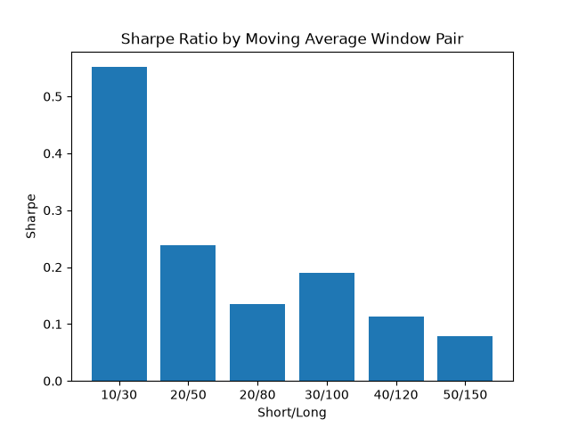
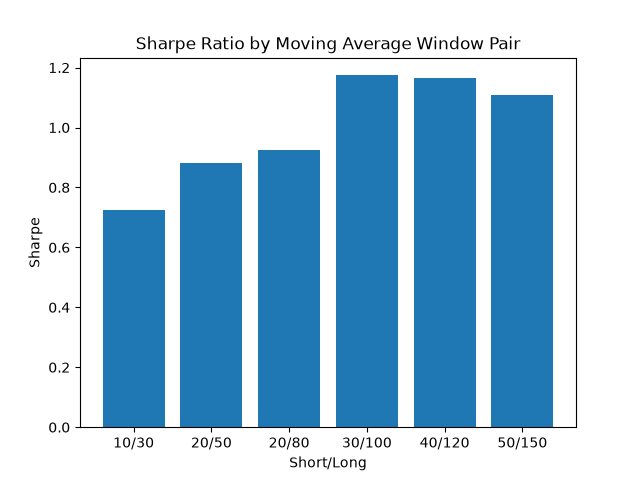

# Momentum & Mean-Reversion Backtesting Engine

A from-scratch backtesting engine for testing two classic trading strategies,
moving-average momentum and z-score mean-reversion, on two different markets:
energy futures and large-cap equities. The focus is on avoiding the mistakes that
make backtests lie: lookahead bias, ignored transaction costs, in-sample
parameter tuning and untested risk overlays.

| Universe | Assets | Period |
|---|---|---|
| Commodities | Brent crude (`BZ=F`), Henry Hub natural gas (`NG=F`) front-month futures | 2016-2026 |
| Equities | MSFT, AMZN, JPM, GOOGL | 2016-2026 |

**Language:** Python (pandas, numpy, matplotlib, yfinance)

## Key findings

- **Results depend heavily on the market.** The crossover failed on commodities
  (Sharpe 0.24 vs 0.49 for the benchmark) but cut drawdown on equities (-28% vs
  -38%) at the cost of return. Mean reversion beat the benchmark in-sample on
  commodities but lagged it on equities.
- **Out-of-sample tests removed most of mean reversion's apparent edge.** On
  commodities its Sharpe fell from 0.91 (2016-2020) to 0.60 (2021-2026), against
  0.53 for the benchmark. On equities it matched the benchmark in-sample (1.17 vs
  1.19) and then fell to 0.39 against 0.97.
- **Two lookahead bugs distorted earlier results.** A missing one-day signal lag
  and a same-day leak in the drawdown circuit breaker both produced misleading
  numbers. Both are fixed and described below.

Neither strategy is presented as a trading edge. The project's value is in
testing them honestly.

## Bug 1: the one-day execution lag

A signal computed from today's closing price can't be traded until tomorrow,
because you don't know today's close until the market closes. Skipping this lag
("lookahead bias") is one of the most common ways backtests misstate
performance. Running the identical code and data with the lag removed (`lag=0`
instead of the default `lag=1`, i.e. `signal.shift(0)` instead of
`signal.shift(1)`) changes the results sharply in both universes
(reproduced by `lookahead_check.py`):

| Universe | Strategy | Total Return (lagged) | Sharpe (lagged) | Total Return (no lag) | Sharpe (no lag) |
|---|---|---|---|---|---|
| Commodities | Moving Average (20/50) | 12.4% | 0.24 | 80.3% | 0.35 |
| Commodities | Mean Reversion (default) | 481% | 0.64 | -100% | -2.32 |
| Equities | Moving Average (20/50) | 369% | 0.88 | 683% | 1.16 |
| Equities | Mean Reversion (default) | 298% | 0.73 | -98.9% | -1.85 |

For the crossover, the lookahead inflates total return from 12% to 80% on
commodities and from 369% to 683% on equities. For mean reversion it does the
opposite in both universes, probably because the entry signal fires on
a day the price has just fallen, so an unlagged position books that same-day
loss and misses the rebound. Lookahead bias doesn't always flatter a strategy;
it makes the results meaningless in either direction. Implementing the lag
correctly (`signal.shift(1)`) was the main engineering focus of `backtest.py`.

## Bug 2: the drawdown circuit breaker

The first version of the circuit breaker had three problems:

1. It zeroed a day's position based on that same day's equity, so it avoided the
   loss that triggered it (a second lookahead bug).
2. It was triggered by an *unrestricted* equity curve, not the equity actually
   produced once positions were clamped.
3. It kept charging transaction costs on signal flips while the strategy was
   forced to cash.

Together these made mean reversion look far better than it was: with the buggy
breaker on commodities, mean reversion showed a Sharpe of 1.11 and a -21% max
drawdown. After the fix (the breaker now decides from the previous day's actual
closing equity, costs are charged only on real weight changes, and re-entry
happens after a 20-day cooldown), the same run shows a Sharpe of 0.65 and a -62%
max drawdown.

---

# Results: Commodities (Brent + natural gas)

## Moving Average (20/50) vs equal-weight benchmark

| Metric | Strategy | Benchmark |
|---|---|---|
| Total return | 12.4% | 214.3% |
| Annualized return | 1.2% | 12.2% |
| Sharpe ratio | 0.24 | 0.49 |
| Max drawdown | -73.5% | -63.4% |

The benchmark is a daily-rebalanced equal-weight basket, not a static
buy-and-hold position.


## Transaction cost sensitivity (MA 20/50)

| Cost (bps) | Total Return | Sharpe | Max Drawdown |
|---|---|---|---|
| 0 | 25.2% | 0.26 | -72.9% |
| 10 | 12.4% | 0.24 | -73.5% |
| 30 | -9.4% | 0.19 | -74.7% |
| 50 | -27.0% | 0.14 | -75.8% |


The crossover earns a thin positive return at low cost and a loss at 30 bps and
above.

## Parameter sensitivity (MA crossover)

| Short/Long | Sharpe | Total Return | Max Drawdown |
|---|---|---|---|
| 10/30 | 0.55 | 307% | -56.1% |
| 20/50 | 0.24 | 12.4% | -73.5% |
| 20/80 | 0.13 | -20.4% | -71.2% |
| 30/100 | 0.19 | 1.5% | -63.0% |
| 40/120 | 0.11 | -24.2% | -67.9% |
| 50/150 | 0.08 | -35.0% | -78.6% |



Only the shortest window pair (10/30) is competitive. With six pairs tested, one
good result is expected by chance, so it is not treated as a finding.

## Strategy comparison

Both strategies at 10 bps cost, mean reversion at its default parameters
(20-day window, -1.0 entry threshold) and no circuit breaker:

| Strategy | Sharpe | Total Return | Max Drawdown |
|---|---|---|---|
| Moving Average (momentum) | 0.24 | 12.4% | -73.5% |
| Mean Reversion | 0.64 | 481% | -65.9% |
| Equal-weight benchmark | 0.49 | 214% | -63.4% |


Mean reversion outperforms in-sample, but its drawdown is similar to the
benchmark's, so it is not safer.

## Out-of-sample test (mean reversion)

Parameters were chosen on 2016-2020 only (grid: window in {10, 20, 40}, entry
threshold in {-0.5, -1.0, -1.5}, maximising Sharpe), then run once on 2021-2026.
The chosen setting was a 20-day window with a -1.5 entry threshold.

| Period | MR Sharpe | Benchmark Sharpe | MR Total Return | Benchmark Total Return | MR Max Drawdown |
|---|---|---|---|---|---|
| Train (2016-2020) | 0.91 | 0.44 | 269% | 61% | -58.8% |
| Test (2021-2026) | 0.60 | 0.53 | 120% | 86% | -66.8% |

Most of the in-sample advantage disappears. The test-period Sharpe is only
slightly above the benchmark's, with a worse drawdown, which is within what noise
could produce over five years and two assets.

## Drawdown circuit breaker (mean reversion)

An optional overlay forces the strategy to cash when equity falls more than a
set limit below its peak (here -20%), then re-enters after a 20-day cooldown and
resets the peak.

| | Total Return | Max Drawdown | Sharpe |
|---|---|---|---|
| Without breaker | 481% | -65.9% | 0.64 |
| With -20% breaker | 424% | -61.9% | 0.65 |

The breaker trims drawdown by about four points at a cost of about 57 points of
return, with Sharpe essentially unchanged. It does not cap drawdown at 20%,
because it only acts the day after a breach and resets its peak after each
cooldown, so repeated losses can compound across resets.

---

# Results: Equities (MSFT, AMZN, JPM, GOOGL)

These four stocks are large-cap names chosen with hindsight and were strong
performers over 2016-2026, so the benchmark is flattered. This universe is a
check on a different market, not a representative sample.

## Moving Average (20/50) vs equal-weight benchmark

| Metric | Strategy | Benchmark |
|---|---|---|
| Total return | 369% | 823% |
| Annualized return | 16.8% | 25.0% |
| Sharpe ratio | 0.88 | 1.07 |
| Max drawdown | -28.3% | -37.9% |

The crossover trades return for safety: it underperforms the benchmark during
this sustained bull market, but with a shallower drawdown.


## Transaction cost sensitivity (MA 20/50)

| Cost (bps) | Total Return | Sharpe | Max Drawdown |
|---|---|---|---|
| 0 | 438% | 0.95 | -26.2% |
| 10 | 369% | 0.88 | -28.3% |
| 30 | 258% | 0.74 | -32.4% |
| 50 | 173% | 0.61 | -36.9% |


Sharpe falls from 0.95 to 0.61 as costs rise from 0 to 50 bps, so the strategy's
profile depends on trading cheaply, though it stays profitable at every level
tested.

## Parameter sensitivity (MA crossover)

| Short/Long | Sharpe | Total Return | Max Drawdown |
|---|---|---|---|
| 10/30 | 0.73 | 239% | -52.0% |
| 20/50 | 0.88 | 369% | -28.3% |
| 20/80 | 0.92 | 416% | -44.9% |
| 30/100 | 1.17 | 752% | -29.6% |
| 40/120 | 1.17 | 817% | -27.9% |
| 50/150 | 1.11 | 690% | -28.7% |



Longer windows score better here, consistent with short windows reacting to price
noise and paying more in costs. Two longer pairs reach a Sharpe slightly above
the benchmark's 1.07, but they were chosen by looking at the full period and were
not tested out of sample, so this is not treated as a robust edge.

## Strategy comparison

Both strategies at 10 bps cost, mean reversion at default parameters and no
circuit breaker:

| Strategy | Sharpe | Total Return | Max Drawdown |
|---|---|---|---|
| Moving Average (momentum) | 0.88 | 369% | -28.3% |
| Mean Reversion | 0.73 | 298% | -28.2% |
| Equal-weight benchmark | 1.07 | 823% | -37.9% |


Momentum outperformed mean reversion here, consistent with the sustained bull
market: momentum strategies ride trends, while mean reversion suits range-bound
markets. This is a regime-dependence observation, not evidence that either
strategy is better in general.

## Out-of-sample test (mean reversion)

Same procedure as for commodities. The chosen setting was a 10-day window with a
-0.5 entry threshold.

| Period | MR Sharpe | Benchmark Sharpe | MR Total Return | Benchmark Total Return | MR Max Drawdown |
|---|---|---|---|---|---|
| Train (2016-2020) | 1.17 | 1.19 | 246% | 254% | -28.5% |
| Test (2021-2026) | 0.39 | 0.97 | 37% | 164% | -37.5% |

Mean reversion only matched the benchmark in the training period and fell well
short of it in the test period, with a similar drawdown. There is no
out-of-sample evidence of an edge on these stocks.

## Drawdown circuit breaker (mean reversion)

| | Total Return | Max Drawdown | Sharpe |
|---|---|---|---|
| Without breaker | 298% | -28.2% | 0.73 |
| With -20% breaker | 218% | -30.5% | 0.67 |

On equities the breaker hurt on every metric, including drawdown. The likely
cause is that forced cash periods cause the strategy to miss rebounds, and the
cooldown and peak reset let later losses compound. This shows that a risk overlay
needs testing like any other component and should not be assumed to help.

---

## Methodology

1. **Data**: daily closing prices via `yfinance` (`data.py`), with a synthetic
   random-walk generator for offline testing
2. **Signals**: moving-average crossover (`strategy.py`: long when short MA >
   long MA) and z-score mean-reversion (entry/exit thresholds with stateful hold
   logic between them)
3. **Backtest**: signals lagged one trading day before execution, equal-weighted
   across active positions, transaction costs charged on actual weight changes,
   optional drawdown circuit breaker driven by the previous day's closing equity
   (`backtest.py`)
4. **Metrics**: total/annualized return, Sharpe ratio (0% risk-free rate), max
   drawdown, benchmarked against a daily-rebalanced equal-weight basket
   (`metrics.py`)
5. **Verification**: `verify_readme.py` re-runs the pipeline for both universes
   and checks every figure in this README against a fresh computation

## Limitations

- Small universes (two commodities, four equities) over one ~10-year period, with
  a single train/test split. This is not a statistically robust sample.
- The four equities were chosen with hindsight and are correlated large-cap
  names, so the equity benchmark is flattered (survivorship and selection bias).
- `yfinance` continuous futures (`=F`) are stitched front-month contracts, so
  prices can jump at contract rolls and create artificial returns. Roll-adjusted
  data would be more reliable.
- WTI crude (`CL=F`) was excluded because its front-month price went negative on
  20 April 2020, which makes percentage returns meaningless.
- The chosen out-of-sample parameters sit at the edge of the grid in both
  universes (entry -1.5 for commodities; window 10 and entry -0.5 for equities),
  so the true optimum may lie outside it.
- The moving-average parameter choices were not tested out of sample
- Sharpe ratio assumes a 0% risk-free rate for simplicity
- Equal-weighting only, with weights normalised across active positions (so a
  single active asset holds 100% of the portfolio). No volatility targeting.
- Long-only or cash, with no short positions
- No market impact or slippage beyond a flat per-trade cost

## If I had more time

- Extend the parameter grid and use walk-forward validation instead of one
  train/test split, including for the moving-average strategy
- Use roll-adjusted futures data, and add more commodities (metals, refined
  products) and a broader, less hindsight-biased equity universe
- Add fundamental data (e.g. EIA inventories) and test whether it explains when
  the strategies work
- Add short positions and volatility-scaled position sizing

## Running it

```bash
pip install pandas numpy matplotlib yfinance
python main.py
```

This runs both universes, regenerates the charts into `output/commodities/` and
`output/equities/`, and prints the metrics tables shown above.
`test_outputs.py` is a smoke test that verifies all expected output files were
created, and `verify_readme.py` checks the README's figures against the code:

```bash
python test_outputs.py
python verify_readme.py
```

## Project structure

```
backtester/
├── data.py          # price loading (real + synthetic)
├── strategy.py      # momentum + mean-reversion signal generation
├── backtest.py      # trade simulation: lag, costs, drawdown breaker
├── metrics.py       # Sharpe, drawdown, returns
├── main.py          # runs all analyses for both universes, produces charts
├── test_outputs.py  # smoke test for output files
├── lookahead_check.py # runs each strategy with and without the execution lag
├── verify_readme.py # checks README figures against the code
└── output/
    ├── commodities/ # generated charts
    └── equities/
```